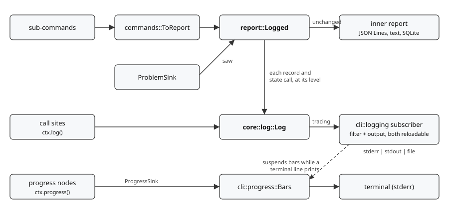

# Logging

How a run tells the person running it what is happening. The report is a different thing with a different reader; see [reporting.md](reporting.md).

## The log and the report answer different readers

The report records observations for analysis and for later runs to consume. The log tells the person at the terminal, and a developer reading along, what progress was made, what remains, what went wrong as it happened, and which execution paths the run took.

**The log sees everything the report sees, plus more.** Neither side was reshaped to fit the other: the report keeps its record types and its `Message` ids, and the log keeps plain U.S. English. A tee between them hands every report call through unchanged and logs a line for it.



## Where each piece lives

| Module | Role |
| --- | --- |
| `core::log` | `Log`, `Level`, and the `Emitter` trait. The default emitter forwards to `tracing`, and this is the only code that names a `tracing` macro. |
| `core::ctx` | Carries a `Log` for every layer, set with `Ctx::logging_with`. |
| `session` | `Session::logging_with`. `Hosts` holds a `Log` because hosts bind lazily with no `Ctx` in reach. |
| `report::logged` | `Logged`, the tee. `pub(crate)`. |
| `cli::logging` | Reads the flags, installs the `tracing_subscriber` subscriber, and reconfigures it once the configuration loads. |
| `cli::progress` | `Bars`, the `indicatif` rendering of `core::progress`. |
| `main` | Installs logging first, and hands the bars to `Ctx` as its progress sink. |

The subscriber is assembled in `cli`, not `core`: `core` does no I/O, and opening a log file is I/O. The library never installs a global subscriber; only `main` does, so an embedder's own subscriber or `Emitter` is never fought over.

`Ctx::new` and `Session::open` kept their signatures. Both default to the `tracing`-backed `Log` and take another through a builder, the same pattern as `Ctx::deciding_with`.

## The tee

**`Logged` logs in `write`, the one funnel for records.** Its `Watch::saw` writes a problem record through that same `write`, so a problem logs exactly once. `ToReport` no longer watches the problem sink; it only turns the walk's vocabulary into records.

**`Logged` also wraps `ReportState`.** Each bind, checkpoint, claim, close, holding, and download logs at `debug`: these are the actions within an artifact. It exposes state exactly when the inner report keeps some, so a line report still answers `None`. `query` passes through unlogged, because it reads rather than observes.

`ReportWriter` is implemented for `Arc<W>`, so one `Logged` serves as the walk's writer (inside `ToReport`) and as the sink's watcher. `subcmd::logged` builds the pair.

Lines render from each record's own fields and `Message::render`, not from the text report format. The two serve different readers, and sharing the code would tie a change to one to the other.

## Levels

The levels mirror `tracing` one to one: `trace`, `debug`, `info`, `warn`, `error`, and `off` for a filter. The command line, `RUST_LOG`, and `setup.log.level` all speak that vocabulary, so nothing needs translating.

| Flag | Level | Secrets |
| --- | --- | --- |
| (none) | `setup.log.level`, else `warn` | redacted |
| `--quiet` | `error` | redacted |
| `--verbose` | `info` | redacted |
| `--debug` | `debug` | redacted |
| `--unsafe-debug` | `debug` | revealed |
| `--tracing` | `trace` | redacted; revealed with `--unsafe-debug` |

**The first level flag given wins.** It is found by scanning the raw arguments, stopping at `--`, after clap has validated them. Clap's argument indices cannot answer it: a flag that was not given still has an index, and global flags carry positions per sub-command. `--unsafe-debug` reveals secrets wherever it appears, even when an earlier flag decided the level.

**Precedence is flags, then `RUST_LOG`, then configuration, then `warn`.** An unparsable `RUST_LOG` is ignored: it is an environment variable, often set for some other program.

**Dependencies log at `warn` or the chosen level, whichever is quieter.** `--tracing` then shows this tool's paths rather than every HTTP frame.

What each event logs at:

| Event | Level |
| --- | --- |
| Header (run start) | `info` |
| Artifact outcome | `info` |
| Actions within an artifact | `debug` |
| Summary | `warn` |
| Problem, `ignore` | `info` |
| Problem, `warn` or `stop-spider` | `warn` |
| Problem, `skip-artifact` or `abort` | `error` |

The summary is at `warn` because the common user wants to know what happened. It logs once, from the summary record; the sub-commands' `describe` functions stay public for embedders but are no longer logged. An `ignore` problem is at `info`, shown by `--verbose`, because the policy said it does not matter. The summary names those apart, `12 problems (10 ignored)`, so its count matches what the default output showed. A problem logs once, through the report's problem watch; a site that reports one does not also log it.

## Starting in two steps

Logging has to start before the configuration loads, since loading it can fail and that failure needs reporting:

```text
  flags + RUST_LOG --install-->   subscriber (filter, output)
  setup.log        --configure--> reload whatever the flags left open
```

**The filter and the output are separate `reload` layers.** Reloading a layer that carries a per-layer filter loses the filter's registration, so the filter is a layer of its own beneath the output.

`configure` sets the level only when neither a flag nor `RUST_LOG` did, and the file only when `--log-file` did not. `validate-config` does not apply `setup.log`: it loads configuration through its own path, and its subject is the configuration rather than a run.

## Destination and format

- `--log-file`: absent means `setup.log`'s file, then standard error. `-` means standard output, and is refused when the report also goes there, since interleaved lines would parse as neither.
- `setup.log` accepts a `config-relative-path` or a `working-dir-path`, like every other path in the configuration. A stream is chosen on the command line only.
- `ansi` adds color only when the destination is a terminal; `plain` never does; `json-stream` writes one JSON object per line.

## Progress bars

`Bars` implements `ProgressSink` over an `indicatif::MultiProgress`. A node with a total draws as a bar, one without as an activity line that becomes a bar once its total grows, and children indent beneath their parent.

**A total is known up front where it is cheap.** A walk from a report database (`copy --db`, `inspect --db`) counts its whole outstanding or inventory list in one query, so the bar reads `300/50000` rather than one 256-artifact page at a time; the spider then adds only dependencies, and rows never handed over are advanced at the end. `find` takes the enumerator's `count()` when the walk is neither sampled nor narrowed by `since`. A walk from arguments or lock files grows its total a batch at a time.

**The bars start hidden, and `configure` decides.** They show for `ansi` when the effective filter's most verbose level is `warn` or more, so `--quiet`, `plain`, and `json-stream` show none. The level comes from the filter itself, so a `RUST_LOG` directive decides the same way a flag does. `indicatif` draws nothing when standard error is not a terminal.

**Terminal log lines suspend the bars.** Output to standard error or standard output goes through a writer that clears the bars, writes, and redraws them, so a line never tears through a bar. A file destination skips this; the bars are not there.

**Each bar is created with a hidden draw target.** An `indicatif` bar that has not yet joined a `MultiProgress` draws straight to standard error by itself, which showed a stray frame and, under `--quiet`, bars that should not have been there at all.

`tracing-indicatif` was not used: it ties bars to spans, and the progress tree is not span-shaped.

## Known limits

- **Every event has the target `artifact_copy::core::log`**, because `tracing` fixes an event's target at its call site and every event passes through `Log`. A per-module `RUST_LOG` directive therefore matches nothing. Tracked in [TODO.md](../../TODO.md) under *Per-module log filtering*.
- **`--unsafe-debug` reveals request headers, not error bodies.** A refused request's credential headers print in full; an error body's echoed credentials stay redacted, and a JSON body is kept as sent, unredacted, at every level. Tracked in [TODO.md](../../TODO.md) under *Redact JSON error bodies, and reveal them under `--unsafe-debug`*.
- **Splitting `setup.log` across files can fail.** First-wins merging is per key, so one file's `config-relative-path` and another's `working-dir-path` both survive the merge, and loading rejects the result. Accepted, and documented under [Logging](../configuration-general.md#logging).
