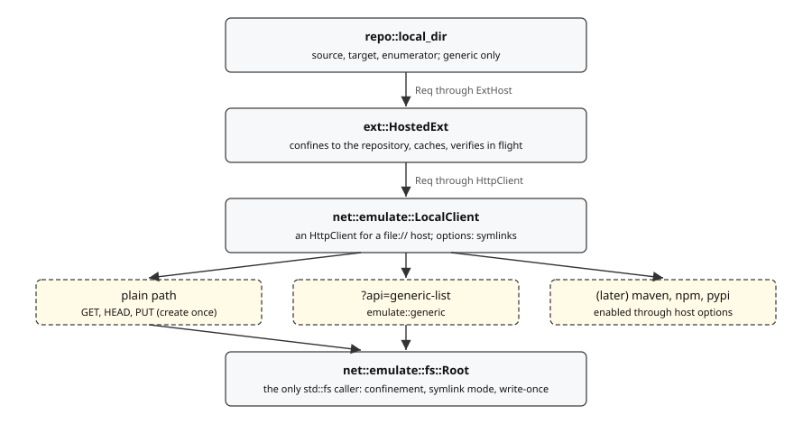

# Sources, Targets, and Enumerators

References: [npm registry API](https://github.com/npm/registry/blob/main/docs/REGISTRY-API.md), [Maven repository metadata](https://maven.apache.org/ref/current/maven-repository-metadata/repository-metadata.html).

## Repository managers are not registries

Nexus and Artifactory are **products hosting many registries**: one API, one credential, one pagination cursor, several ecosystems. The interfaces were already shaped for this -- `Description.ecosystems` is a list and `Source::ecosystem` takes the artifact -- so each is one extension declaring several ecosystems, never `nexus-maven` plus `nexus-npm` plus `nexus-pypi` sharing state they have no way to share.

- `repo::nexus::enumerator` reads `/service/rest/v1/components`. It is the first enumerator able to report anything but `LastDownload::Unknown`.
- `repo::artifactory` reads AQL, which required `Method::Post`, since AQL is a query body rather than a path. `artifactory` pages a sorted query by offset, which needs Pro; `artifactory-oss` pages an unsorted one by `created` window. Row folding and coordinate reading are shared in `artifactory/fold.rs`.
- `repo::artifact_keeper::enumerator` reads the artifact list by keyset cursor and recovers coordinates from the stored path; see [artifact-keeper-api.md](artifact-keeper-api.md).
- Nexus and Artifactory report `LastDownload`, since both record a last-downloaded timestamp per asset. Artifact Keeper does only under `last-download: stats`, at one request per file. The three-state enum exists for exactly this: most enumerators can only answer `Unknown`.
- Configuration declares the URL, the repository name, and the ecosystem explicitly. Auto-detection is a later convenience, not the first cut.

`repo/manager.rs` holds the two things they share -- `manager::config(options, kind)` and `manager::describe(&ecosystem)` -- and its module doc holds the reason they share them. The missing-ecosystem error reads "{kind} needs..." rather than "a nexus enumerator needs..." / "an artifactory enumerator needs...", which would have forced the shared message to carry the English article as data or compute it; it serves the sources too.

**`walk()` stayed apart**, and the two bodies look far more alike than they are: Nexus filters *after* paging, so an empty page is not the end and only a missing continuation token is; Artifactory stops on a short page of rows. A shared walk would have to reconcile two contradictory stopping conditions, and getting it wrong truncates a catalog silently. The URL builders stayed apart too -- a REST query string and an AQL document share only a base URL.

### Nexus repeats `lastDownloaded`

**Confirmed against a real Nexus 3, and fixed.** A components page emits `lastDownloaded` **twice** on one asset, `null` first and then the real timestamp:

```text
  "lastDownloaded" : null,
  "uploader" : "admin",
  ...
  "lastDownloaded" : "2026-09-10T04:42:28.414+00:00",
```

A derived `Deserialize` refuses that outright with *duplicate field `lastDownloaded`*, which failed the page and so the whole walk. `find` against a real Nexus did not work at all.

`repo::nexus::enumerator::component::Asset` is hand-deserialized and folds the repeats. **The most recent observation wins, not the last one** -- the same rule `Component::last_download` already applies across an artifact's assets, so a repeat is just another observation of the same thing. Order-independent on purpose: a server emitting the timestamp first would otherwise have it silently replaced by the `null`, and reporting "never downloaded" for something used last week is exactly the mistake that gets a live artifact deleted.

**What is not covered.** A duplicate of any *other* field is still refused. That is deliberate -- this quirk has been seen and a repeated `name` has not, and failing loudly on something unexplained beats silently picking one of two values -- but it means a second quirk of the same shape would break a walk the same way. If one turns up, the fix is the same hand-written visitor; what needs deciding then is whether Artifactory's rows want the same treatment, since nothing has been observed there and its AQL responses are assembled differently.

The sample page lives in `local-cache/`, which is git-ignored, so the committed tests carry a trimmed copy of its shape instead.

### Two Artifactory walks, not one with a switch

OSS refuses any AQL sort, and an offset into an unsorted result is not a position, so the OSS walk pages by **upload time**: each page is the files `created` in one half-open window. A window that fills the row limit lost rows nobody can name, so it is halved and asked again; one millisecond that still fills it is fetched without a limit. A sparse window doubles for the next page. The first window runs from the epoch to the start of the walk, which answers a small repository in one request, and that fixed end means a file uploaded mid-walk is the next walk's.

The choice between a mechanism option inside `artifactory` and a second kind went to the second kind for the reason the Nexus and Artifactory walks are apart: each paging rule stays its own, and a cursor never has to record which mechanism issued it.

### Enumerators that need a login

Artifactory refuses AQL to an anonymous caller on every edition, even on a repository it serves anonymously. `repo::enumerate::login` declares that per kind, so `validate-config` reports it and `find` refuses before the first request rather than on it. The message names the native protocol enumerator for the repository's ecosystem, since a user with no login has no other way to walk it. `anonymous: attempt` lifts the check, for a release that someday allows anonymous AQL.

## Repository-manager sources

`nexus`, `artifactory`, and `artifact-keeper` are sources as well as enumerators. Each wraps the ecosystem's protocol source (`maven`, `npm`, `pypi`) at the repository's path and adds what the server's API knows; `repo::manager::ManagedSource` does the wrapping and each product supplies a `Lister`.

**The protocol source stays authoritative.** It decides whether an artifact exists and which files it has, and it is the only side that attaches signatures and PEP 658 metadata. Replacing its file list with the server's would drop both. So the listing adds to it:

| Server file | Becomes |
| --- | --- |
| also named by the protocol source | its digests and size merged in; a disagreement refuses the artifact |
| not named, Maven release, whole coordinate | an extra file: classifiers, `.module` |
| not named, anything else | dropped |

Only Maven gains files, because only Maven's source builds names from the POM; npm's packument and PyPI's simple index list every distribution, and what else a server stores beside one (Nexus keeps PyPI's `.whl.metadata` as an asset) is not a distribution. A snapshot gains none, since the server holds every timestamped build and the protocol source chose one. A coordinate naming a classifier or type names one file already.

The publish time is the server's newest file when it has one: Nexus's `blobCreated`, Artifact Keeper's `created_at`, and the later of Artifactory's `created` and `lastModified` (a redeploy moves only the second, and an uploader can set the second).

**Versions** come from the server only where the protocol's index can be stale. Nexus does not rebuild `maven-metadata.xml` on upload, so its Maven versions come from `search`; Artifactory and Artifact Keeper rebuild it, and npm and PyPI indexes are generated from what the server holds.

| Lister | Endpoint | Cost per version |
| --- | --- | --- |
| Nexus | `service/rest/v1/search` | one request per page of components, following the continuation token |
| Artifactory | storage API folder info, then file info | 1 + one per non-sidecar file; `?list` would be one, but is Pro only |
| Artifact Keeper | artifact list with `path_prefix` | one page per 100 files |
| Maven directory index | the version directory's HTML autoindex | one, and none for a snapshot; names only |

The last is not a product: `kind: maven` with `file-listing: html-index` wraps the Maven source with `repo::maven::listing`, for any host serving a directory autoindex. It is how the `maven-central` server kind sees classifiers, `.module`, and SBOMs without enumerating Central's catalog, which its terms forbid; one request per version already being resolved is inspection. The index carries no digests, so those files are verified at `copy` as the payload is, by sidecar and by the `.asc` the index also lists.

Raw has no protocol to wrap, so `nexus`, `artifactory`, and `artifact-keeper` with `ecosystem: raw` read the API alone; see the next sections. `version_scheme` takes the options for this reason: one kind is `Declared` under raw and `Fixed` otherwise.

## Protocol enumerators

**A walk can be narrowed to what changed** (`Enumerator::narrowing`, `walk_since`). `find` passes the start of the last walk that reached the end (`ReportQuery::last_complete_enumeration`) unless `--rescan-all` or a sample says otherwise. Only the Artifactory enumerators narrow, on the server and by `modified` rather than `created`, since a redeploy moves only `modified`; `artifactory-oss` starts its first window at the date, and `artifactory` adds a `modified` clause to its sorted query. Nexus (`blobCreated`) and Artifact Keeper (`created_at`) carry a time per item but no server filter, so they walk everything, as do the protocol enumerators. The default `walk_since` walks everything, a superset that loses nothing, and the omit and failover wrappers forward both. The walk records `since=DATE` as its scope, so a resumed walk keeps its narrowing and `source_listed` never counts it as a full listing.

Three enumerators walk an ecosystem's own protocol rather than a product's API, so they work on any server that speaks it, anonymously where the repository allows. There is no Maven Central enumerator: its terms forbid enumerating the catalog, and the published index is 3.3 GB, rate-limited, and deprecated (see [server-behaviors.md](server-behaviors.md#maven-central-index)).

- **`maven-html-index`** (`repo::maven::enumerator`) walks a directory autoindex depth first, children in name order. An artifact directory is one whose `maven-metadata.xml` names it as its `artifactId`; a snapshot version directory and a plugin group hold one too and name something else. Every version the document lists is listed, snapshots with every timestamped build, and so is a child directory the document omits that holds `{artifact}-{child}.pom`, reported as `maven-index-version-unlisted`: somebody copying every version should get every version. The cursor is the last emitted directory's path, and a walk resumes by descending along it from the root, so it holds one directory's children per level and nothing that grows with the repository. A Central host is refused when opened and by `validate-config`.
- **`npm-replicate`** (`repo::npm::enumerator`) pages a CouchDB `_changes` feed by `since`, with `last_seq` as the cursor, and reads each name's packument from `registry` (default: the feed's own url). The feed carries names only, since npm's refuses `include_docs`; reading versions from the registry protocol lets any npm registry supply them behind any feed. A packument the registry no longer holds is `artifact-not-found` for that package, not the walk. The total is the database's `doc_count`.
- **`pypi-simple`** (`repo::pypi::enumerator`) reads the PEP 691 index, names only.

## Omitting files and artifacts

`repo::Omit` is one rule set for what an artifact leaves out: the ecosystem's built-ins (`ecosystem::joins_listing`: checksum sidecars, and for Maven `maven-metadata*.xml` and `_remote.repositories`), plus the configured `omit` rules of the entry, each a `files` glob (`internal::glob::matches_file_name`), a `purl` pattern (`internal::purl::pattern::covers`, the quarantine rules' matcher), or both. Configured rules only omit more.

**Applied once per role, by a wrapper, never inside an implementation.** `Sources::build` wraps every source it builds, proxies and their upstreams included, in `OmittingSource`; `Enumerators::build` wraps every enumerator in `OmittingEnumerator`; `Session` wraps every target in `OmittingTarget`. An enumerator or source no longer filters its own listing, so an extension gets the same omissions as a built-in. Artifactory's `fold::is_not_an_artifact`, Artifact Keeper's enumerator check, Artifactory's lister skip, and `MavenSource`'s own `retain` stay: they decide whether a row *is* an artifact, save a request, or guard names the source builds itself, which is not the same question.

- **Source.** An omitted file is never fetched, and `versions` hides what a whole-artifact rule covers, so a range never selects it. `Source::offered` applies the rules to an artifact answered from elsewhere: `InventorySource` asks it of every recorded answer, so a rule added since the record still applies. Offering is idempotent.
- **Enumerator.** An omitted file or artifact is not recorded. The count is the inner one, since counting what is left out would mean a walk.
- **Target.** Files are fetched and verified as usual, then not uploaded, each with its own staged path. A whole artifact is decided by `Target::omitted` in `copy` before anything is fetched for it, and closed as `refused` -- terminal, and not a failure -- rather than graded as a failed upload.

**Files, not documents.** An omission decides which files an artifact has, never what is read to learn them: omitting `maven-metadata.xml` or `*.pom` does not stop the Maven source fetching either.

A configured omission is reported: `file-omitted` is `ignore`, since `*.sha256` can match every artifact, and `artifact-omitted` is `warn`. A built-in one is not, as it never was.

## Proxy sources and enumerators

A *proxy* source is one built from other sources rather than from a host. The thing a proxy does -- choose among several answers to "where does this artifact come from" -- is a read-side question, so there is **no proxy target**: writing to several targets at once is a different feature with different failure modes (partial success, rollback) and must not arrive through this door.

Three concrete kinds exist: `proxy-failover` as a source and an enumerator, and `proxy-merge` as a source.

**Sources and enumerators are separate namespaces, and the code keeps them so.** `ProxyTo` names sources under `ref`/`source`; `ProxyToEnumerator` names enumerators under `ref`/`enumerator`. They are two types rather than one parameterized, because the inline key is the user-facing spelling and a generic could not change it. More importantly the *checks* are separate: an enumerator `ref` must never resolve against `sources`, and sharing the code would mean parameterizing on exactly the thing that must not be confused. A test asserts an enumerator `ref` naming a same-named source is reported as unknown.

**The list type is generic.** `Upstream` and `Upstreams` moved out of `repo::proxy` into a shared `repo::upstream` module the moment there was a second user, as `Upstreams<T>` over an unsized `T`. The one rule that needs to know what an upstream *is* -- the ecosystem check -- sits behind a `Proxied` trait each extension point implements for its own trait object. `repo::proxy` and `repo::proxy::enumerator` then differ only in what they proxy.

### Two rules the enumerator side needs and the source side does not

- **Termination is never reimplemented.** The proxy asks one upstream for one page and believes whatever it says about whether there is more. This is the *do not merge these* rule about the four `walk()` implementations, arriving as a positive design constraint: Nexus says an empty page is not the end and Artifactory says a short page is, and a proxy applying either rule to the other truncates a catalog.
- **Falling over is only possible before the first page.** A source proxy may fall through per artifact, because each artifact is an independent question. A catalog is not: abandoning one halfway to start another upstream would re-report everything already emitted, and every count downstream would be wrong. So an upstream is chosen once -- a failure before its first page tries the next, a failure after it is returned.

Cursors are `"<index>:<whatever the upstream said>"`, split on the **first** colon only since an upstream's cursor may contain any number. An index with no colon means *start this upstream*. A cursor that does not parse is refused rather than restarted, because restarting would re-report the whole catalog.

### Merging belongs on the source side

The reframing that settled this: **the common reason to want a "merge" is asking which versions of one artifact exist**, not walking a catalog. That is a `Source::versions` question, and there the answer is bounded by the artifact's release history -- a few hundred strings, already being held to be returned. Deduplicating a *catalog* is bounded by nothing. Same operation, two completely different costs.

- **`proxy-merge` (source)** unions every upstream's version list, deduplicated by version text. The motivating pair is a release repository and a snapshot repository: neither is a subset of the other, and failover would report the releases and silently omit every snapshot.
- **`proxy-failover` (source and enumerator)** is right when the upstreams are a hot standby, or nested subsets where the first holds everything the second does.
- **A merging enumerator is not planned.** A full walk of proxied enumerators follows failover only, and a merging *source* proxy does not get a matching enumerator: its catalog walk under-reports by construction. Refusing the walk outright, with a message pointing at the workflow below, is the likely shape.

A user who honestly wants a full walk over two joined repositories is pointed at files rather than at a proxy:

1. `inspect` each repository, saving each catalog to its own report.
2. Join the reports with a merge command.
3. Use the joined report as an enumerator source.

This is better than an in-process merging enumerator and not merely cheaper. The working set is a file rather than resident memory; the two `inspect` runs need not happen at the same time or on the same machine; and the joined report is an artifact a person can inspect, diff, and keep.

### What a proxy receives

An **ordered list** of upstream sources, each with an **optional, non-unique classifier** string. Both halves are load-bearing and a given proxy may use either, neither, or both:

- **Order** expresses precedence. The failover proxy is nothing but an ordering.
- **Classifier** assigns a responsibility -- "this one is the release repository, that one is snapshots" -- for a proxy whose upstreams are not interchangeable.

A proxy may put its own restrictions on what it will accept: a minimum or maximum count, classifiers that must be unique, or exactly one of a named set. These are checked when the proxy is built, not when it is first used, so a misconfiguration is a startup error rather than a failure partway through a walk.

### Configuration

A source declaration carries a `proxy-to` list when, and only when, its kind is a proxy kind. Each entry is one of two shapes:

```yaml
sources:
  central:
    host: maven-central
    kind: maven

  combined:
    kind: proxy-failover
    proxy-to:
      - ref: central            # a name in the top-level `sources`
        classifier: primary
      - source:                 # described here and nowhere else
          host: mirror
          kind: maven
        classifier: fallback
```

**A `ref` must name a non-proxy source; only a `source` may itself be a proxy.** That single rule is the whole cycle prevention: inline definitions nest structurally and therefore cannot close a loop, and names -- which could -- are not allowed to reach another proxy. No graph walk is needed and none should be added.

**A `ref` is shared, not copied.** Two proxies naming `central` get the same instance, which is both the intuitive reading and the useful one: a source owns caches (`Coalesced`), so sharing means one packument cache rather than one per referring proxy. The builder therefore memoizes by name.

**A proxy declares no `host`.** Its I/O happens in the upstreams, each of which names its own. `host` is required on every other source and must be **forbidden** -- not merely optional -- exactly when `proxy-to` is present. Forbidden rather than optional because an ignored field a user can still set is worse than one they cannot: they would reasonably expect it to mean something.

**The exception, which must be conspicuously documented wherever it is used.** A proxy may genuinely need a host of its own -- one that consults an index to decide which upstream should answer has to fetch that index from somewhere. Such a proxy takes it from `options`, **never** from the `host` field, because the field means *the host this repository is* and that is not what the value is for. It should name the option for the job it does -- `index-host`, say -- rather than `host`. An option spelled `host` beside a forbidden `host` field is the most confusing arrangement available.

**Proxy kinds are built-in only.** A `kind` naming an entry in `extensions` is never a proxy. This is a restriction on the *configuration loader*, not on the extension mechanism: an embedder composing sources in their own code is unaffected. The reason is narrow -- the loader has to know, before it builds anything, whether a declaration's `proxy-to` is meaningful, and asking an extension would mean running it to find out.

### What `validate-config` checks

Five rules the schema cannot express, because it validates one document at a time and does not know which kinds are proxies:

| Complaint | What it catches |
| --- | --- |
| `proxy-to-on-plain-source` | `proxy-to` on a kind that is not a proxy |
| `proxy-names-a-host` | a proxy kind carrying `host` |
| `proxy-ref-unknown` | a `ref` that names no declared source |
| `proxy-ref-is-a-proxy` | a `ref` into another proxy -- the cycle rule |
| `proxy-refused-its-configuration` | whatever the proxy itself says |

The enumerator collection has the same five, under `proxy-to-on-plain-enumerator`, `proxy-enumerator-names-a-host`, `proxy-enumerator-ref-unknown`, `proxy-enumerator-ref-is-a-proxy`, and `proxy-enumerator-refused-its-configuration`.

The last one is the interesting one: arity and classifier rules are the *proxy's* and nothing outside it can enumerate them, so the sound configurations are **built** and asked. Building performs no I/O.

Two things that fell out of writing it:

- **Inline sources appear nowhere else in the configuration.** A check iterating `config.sources` never sees them, so a typo inside one would have surfaced as a build failure rather than as a finding. `every_source` walks named declarations *and* their inline descendants.
- **A structural fault is reported once.** The build pass runs only when the structural checks found nothing, because building an already-broken configuration says the same thing again in worse words. Sources reached through an extension kind are skipped entirely -- `open_source` knows only the built-ins. The enumerator side needs a **stronger** test than "is it built in": an enumerator kind can refuse its own configuration, as `maven-html-index` refuses a Central host, so buildability is decided by actually opening one, not by consulting the kind list.

Proxy kinds also had to join `source_kinds()` for the "which did you mean" message, or `kind: proxy-failover` would have been reported as a typo.

### Upstreams must be alternatives for something

A proxy whose upstreams are meant as alternative answers to the same question needs them to overlap: a failover from an npm registry to a Maven mirror can only ever answer "not found", because the two hold disjoint sets of artifacts.

The rule is **at least one ecosystem spoken by every upstream**, not *they all speak the same one*. The distinction matters and getting it backwards was the first attempt: `Source::ecosystem` takes the artifact precisely because a repository manager serves Maven, npm, and PyPI from one API, so a Maven registry falling back to a Nexus that also holds npm is ordinary configuration and must not be refused. A proxy then reports the **union** of what its upstreams speak, which is what lets a proxy be an upstream of another proxy.

Answering this needed a gap filled: **`repo::Source` could not say what ecosystem it speaks.** `Source::ecosystems() -> Vec<EcosystemId>` is now a required trait method. `Source::ecosystem` answers *will you take this one*, which is what resolution asks; this answers *what are you*, which is what a composer asks, and a proxy cannot invent an artifact to probe its upstreams with. The cost was four lines per adapter and no logic.

### What `proxy-failover` settles that the next proxy should reconsider rather than copy

- **What counts as "cannot answer".** Falling through on the wrong failure turns a problem into a silence, so it is a short allow-list: `artifact-not-found` and `host-unreachable` fall through; everything else stops. `metadata-malformed` in particular does **not** -- quietly preferring the mirror hides that the primary is serving corruption -- and neither does `aborted`, because trying the next upstream is exactly the work the user asked to stop.
- **Answers are not bound to one upstream.** `versions` may come from the registry and `metadata` for one of those versions from the mirror. For a version present in both with different content, order decides. Binding an upstream per artifact would mean remembering a decision per coordinate -- a map growing with the artifacts walked, which the memory discipline forbids. A proxy that must guarantee one upstream per artifact needs a different design, not a cache bolted onto this one.

An empty version list is treated as "not found" rather than as an answer: a registry that has never heard of a package says so with a 404 or with an empty list depending on how it is written, and stopping at the first would report the artifact missing while the mirror held it.

## GitHub releases

Source only. `Target` is not implemented at all rather than implemented to fail, which is what the separate trait sets were for.

**Only the repositories it lists.** The `repositories` option is required: adding GitHub as a source does not make all of GitHub fair game. An entry is `owner/repo` or `owner/pattern`, with `*` allowed in the repository name and never in the owner, since trust is granted to an owner rather than across owners. Matching ignores case. A request outside the list is refused with `Error::Config` before any request, as the host refuses a URL outside its allow-list, and `validate-config` refuses a missing or malformed list.

**A release is a raw artifact**, named `owner/repo` and versioned by its tag, so only a raw target accepts it; a `name-version-file` target lands its assets at `owner/repo/{tag}/{asset}`. There is no `github` ecosystem: a request parses as any raw coordinate, splitting the tag off at the last `@`, so a tag holding `@` could never be named and is refused rather than listed or taken as the latest. A `names` rule may choose another name.

**A name mapping.** The source-level `names` key holds rules of `from: {name, version}` and `to: {name, version}`, each version holding one `*` or none (absent is `*`), parsed into `repo::NameMap`. `gitleaks/gitleaks@v*` to `tools/gitleaks@*` reads `tools/gitleaks@8.18.0` from tag `v8.18.0`. A request names the `to` side, and `GitHubSource` maps it back at its own boundary, so the mapped purl is the only identity the report, quarantine rules, and targets see; a wrapper source would have left the override below narrowing and reporting under the GitHub name. A repository a rule names is reachable only through its rules, and its tags no rule admits are hidden, so one release cannot land under two names. Every rule is consulted, and a request more than one admits is refused as `name-mapping-ambiguous` rather than settled by rule order. A mapped tag may hold `@`; only the mapped version may not. `validate-config` refuses `names` on any other kind and a mapped repository outside `repositories`.

`GitHubSource` is the only adapter that overrides `Source::resolve`, because tag text supports no ordering worth acting on: an exact tag is fetched by tag, a versionless request is answered by GitHub's own `/releases/latest`, and a range is refused with an explanation rather than approximated. A repository whose tags do follow a convention can say so with `version-handler`; see [versions.md](versions.md).

## Raw and generic repositories

A raw repository has no intrinsic coordinate scheme, and that **only matters for sources**, since it only bears on version matching and artifact name requests. A source defines the file-to-artifact relationship; a raw target simply copies the files into the path. Each raw source applies its `Mapping` itself, reading a listed path into a name, version, and file with `Mapping::read`; a raw target writes with its inverse, `Mapping::path`.

**Any repository can be read as raw**, and written as raw where the server takes a file at a path, wherever the same API calls serve every repository type: `ecosystem: raw` names how the tool reads it, not the repository's format. Artifact Keeper's artifact listing and upload take no format; Nexus needs its browse pages to read a non-raw repository and a `PUT` per file to write one (see *Reading a Nexus raw repository* and [write-path.md](write-path.md#the-nexus-raw-target)). A server refusing a path its format does not allow is the user's problem: the mapping decided the path, and the server's rule stands. Artifactory is out of scope: its raw source, enumerator, and target are for generic repositories, Ivy-typed ones included.

**A raw target takes raw artifacts only.** `artifact-keeper-generic`, `nexus-raw`, `artifactory-generic`, and `local-directory` each refuse an artifact of another ecosystem through `repo::sole_ecosystem`: only a raw source says what path each file belongs at, and inventing a layout for a Maven or npm artifact is a decision about the target's shape that belongs to whoever configures one.

## Reading a Nexus raw repository

Configured as `kind: nexus` with `ecosystem: raw`; the separate `nexus-raw` kind is gone.

**A repository of another format is read through its browse pages.** `search/assets` matches `group` against a folder only in a raw repository, and `q` matches component keywords rather than paths (both measured; see [server-behaviors.md](server-behaviors.md)), so a search that answers nothing is asked again of `service/rest/repository/browse/{repository}/{folder}/`. Raw keeps the search, which carries digests and `blobCreated`; a browse row has neither, so its files carry no digests and its last-modified time stands for the publish time -- erring toward "too new" if a re-index moved it. The source asks no format, so an anonymous raw source still works: the format endpoint refuses an anonymous caller. The enumerator reads every component's assets as paths whatever its format, one coordinate per asset, and folds those one artifact shares.

Two endpoints list a repository and both were measured against a real one, so the choice is evidence rather than preference.

`/v1/components` is the one to use. It carries each component's assets inline, so one page answers everything; `/v1/assets` returns the same information and takes two to five times as long. For a raw repository the two are one-to-one -- a captured repository gave 65 components and 65 assets -- so nothing is lost by taking the cheaper one.

What a raw component looks like, confirmed against that capture rather than inferred from the API description:

| Field | For raw |
| --- | --- |
| `version` | always null |
| `name` | the asset's path |
| `group` | `/` plus the path's directory |
| `assets` | exactly one |
| `checksum` | an open map; all four of md5, sha1, sha256 and sha512 appeared |
| `lastDownloaded` | absent for a little over half, which is the `Never` case |

**A path's leading separator is not stable across servers.** A production Nexus 3.96 reported `the-path/the-artifact/...` and a freshly configured one reported `/artifact1/1.0/a1.txt`, for the same field of the same API. Both spellings are trimmed before a coordinate is read, or one file would be two artifacts depending on which server answered.

**A file can sit at the repository root**, and the reading that says otherwise is worth stating precisely because it is half true. The component upload API refuses `raw.directory=` with no path, so nothing uploaded that way lands at the root. A plain `PUT` to `/repository/<repo>/<file>` is accepted -- measured, 201 -- and comes back as `group: "/"` with a root-level path. So the case is unreachable through one door and open through the other, and a reader that assumed it away would drop the file.

**Coordinates come from the asset path, not from `group`.** The two agree today, and deriving from the path keeps the mapping independent of one server's grouping rules -- an Artifactory reader can share it, and a change to how Nexus fills `group` cannot silently move an artifact to a different name.

The walk stops on three conditions and all three matter: an absent continuation token, a token equal to the previous one, and a page cap. The middle one is not defensive programming -- Nexus has been observed handing back the same token forever, and the working Python reader carries the same guard.


### Resolving one artifact: `search/assets`, not `components`

Enumeration and resolution use different endpoints, and the reason is a missing parameter rather than a preference. `/v1/components` takes only `repository` and `continuationToken` -- no filter at all -- so answering *what is in this one directory* through it would mean walking the whole catalog per artifact. `/v1/search/assets` takes `group`, and what that means was measured against a running server:

| Filter | Answer |
| --- | --- |
| `group=/artifact1/1.0` | that directory's assets, exactly |
| `group=artifact1/1.0` | nothing -- **the leading `/` is required** |
| `group=/artifact1` | nothing -- an exact match, not a prefix |
| `group=/artifact1/*` | the sub-groups -- `*` is a glob, and it **crosses `/`** |

The second row is the one that would break silently. A group built without the leading separator returns an empty page, and an empty page reads as *this artifact is not here* rather than as a malformed query -- so the repository would appear to hold nothing at all. `group` carries the separator on both servers measured, even where `path` and `name` disagree about it.

The third row is the happy one: `group` matching exactly rather than by prefix **is** the `Directory` mapping's rule, so one request answers one artifact.

The fourth is why every returned asset is re-read through the `Mapping` and kept only where the coordinate matches what was asked for. A real path containing `*` would otherwise be read as a pattern and pull in a subtree. The same check gives `AsIs` and `NameVersionFile` their filtering for free, since neither's artifact is a whole `group`.

`format=raw` is deliberately **not** sent. The endpoint accepts it, and a repository holds exactly one format, so it could only restate what `repository` already says -- and every parameter sent is one more thing that can be wrong against a server nobody has tried yet. The probes above were run without it.

### The publish time is `blobCreated`

Not `lastModified`, and the difference is not cosmetic: in the captured production repository 44 of 65 assets share one `lastModified` month while `blobCreated` spreads across three years. `lastModified` reflects a server-side re-index, so taking it would put an entire repository inside any publish window. The **newest** of an artifact's files wins, because a publish window asks whether anything here is too new to trust yet.

### What each half costs

An enumerator reports what a repository *has*; a source reports what each thing *is*. For a repository of N files in D directories, a full migration is `ceil(N/10)` component pages, D group searches, and N payload fetches. The captured repository -- 65 files, 17 directories -- is 7 + 17 + 65.

## An artifact enumeration's file listing, combined with a resolution

**Enumerators list files, and a listing is never an answer on its own.** This reverses an earlier decision that an enumerator records no files, and the reason that decision gave is what shapes the replacement: a file row would mean either *the catalog said so* or *a resolution named it*, and a later run could not tell which. So the report keeps both, and says which.

The reversal was forced by Maven. A release's version directory has no index: `maven-metadata.xml` lists versions, the POM names its packaging, and nothing names the classifier files (`-sources`, `-javadoc`) or Gradle's `.module` beside them. A source reading the layout cannot find them. A repository manager's catalog lists every one, and throwing that away is what made the first Nexus-to-Artifactory copy carry the POM and the jar and nothing else.

### What a listing holds

`enumerate::Found.files`: name, URL, size, and digests, as the catalog reported them. Only files that belong to the artifact, decided by `ecosystem::joins_listing`: a checksum sidecar is left out (a target writes its own), and so is Maven's repository-managed index; a signature, a `.module`, and a classifier file stay in. Raw keeps everything, because it has no sidecar convention and `data.sha1` in a raw repository is somebody's file.

`repo::nexus::enumerator` lists each component's assets, folding a raw directory's components into one list. `repo::artifactory` lists each row, and a Maven `.asc` joins the artifact of the file it signs but never makes an artifact on its own. A raw row is read through the `mapping`, and any raw file can make an artifact, a sidecar included.

### Where it is stored

One `repository_file` row per file, whoever named it, with `listed_ms` and `resolved_ms` saying when an artifact enumeration last listed it and when a resolution last named it. Digests stay in `repository_file_digest`, accumulated from both. A resolved URL is never replaced by a listed one; a listed URL stands only until something resolves the file. `FileRecord.origin` (`listed` or `resolved`) carries the same distinction in a line report and in the observation history.

### The combination rule

Applied in exactly one place, `repo::InventorySource::metadata`, which both `inspect` and `copy` go through when given `--db`, and implemented as one pure function, `repo::inventory::combine`.

- **R** is the files a resolution names: rows carrying the resolved marker when a `inspect` recorded them, and otherwise the source's own `metadata`. A row carrying only the listed marker never counts toward R, so the source is always consulted and its checks -- a POM's checksum and signature, its license, its dependencies -- always run.
- **L** is the rows an artifact enumeration listed for the same source and exact purl.
- A file is identified by its name.

| Case | Result |
| --- | --- |
| No L | R unchanged |
| A name in R and L | R's URL; digests merged; size R's, else L's |
| A name in L only | Appended after R's files, with L's URL, size, and digests |
| A name in R only | Kept, with no finding |
| The resolution fails | The artifact fails as it would have; L alone is never copied |
| **Mismatch** | One algorithm holding two different digests after merging, or two known sizes that differ |

A mismatch is reported once per artifact as `listing-mismatch` (`skip-artifact`: fail-eventually), naming every file and what differs, and the artifact is refused through `Ctx::refusal`. It is not also returned as an error, which would record it twice.

Three choices in the table are deliberate and worth not re-deriving:

- **A listing is never complete.** A file only R names is not a finding. A directory can straddle pages and a walk can stop part-way, and tracking when a listing *was* complete would cost an enumeration-coverage record per artifact to catch a case -- the source naming a file the catalog lacks -- that the fetch catches anyway, as a 404.
- **A URL is never compared.** The source is what fetches, and a catalog's download host can differ from it or move: PyPI's does.
- **Digests accumulate rather than being replaced.** A repository that changes a file's bytes between two artifact enumerations leaves two values for one algorithm, and the next combination refuses the artifact. That is the finding wanted: the same coordinate now names different bytes.

The merged digests become the file's expectations, so `copy` checks the bytes against what the catalog reported. That is what makes a Maven payload verifiable at all -- the source leaves its sidecars unfetched during inspection.

`inspect` records the combined list as resolved, so an appended file gains the resolved marker too, and every later read combines again against whatever L is current.

### Two rules the directory mapping reaches first

Folding several components into one artifact makes two situations ordinary that were previously unreachable, because every other enumerator emits one component as one row on one page.

- **Findings repeat across pages, deliberately.** A page's repeats are folded, but nothing is remembered between pages: a set of every artifact seen grows with the catalog, which the memory discipline forbids. The straddling is certain rather than theoretical -- the captured repository has 42 of 65 components in one group, five pages of one artifact -- and the report database converges the repeats through its upserts.
- **A later "never downloaded" no longer erases an earlier timestamp.** `repository_artifact`'s merge was last-evidence-wins, which was correct while two observations of one artifact were impossible. Now a directory's files straddle a page and a later page reporting a file nobody fetched would overwrite an earlier page's record of one that was -- reporting disuse for something in use, which is the mistake that gets a live artifact deleted. `LastDownload::merged_with` states the rule; `report::db::inventory` repeats it in SQL, where it cannot call that.

### Artifacts with no version

`Mapping::Directory` gives an artifact no version, and `ResolvedArtifact.version` is `Option<Version>` because of it. Every neighbouring type already said so -- `Found.version`, `Work.version`, `ArtifactRecord.version`, `Coordinate.version`, and the nullable `artifact.version` column -- and this was the one holdout.

The alternative was a synthetic empty version, and it is worth recording why it was refused: `purl_at("")` renders a trailing `@`, which `purl::parse` reads back as no version at all. The round trip breaks exactly where the transfer claim, the cache lookup and the target's `holds` query compare purls, so a copy would re-fetch what it already held and never recognise what it had published.

`Source::versioned` is what lets resolution skip selection entirely rather than hunt through an empty candidate list, and **a decorator must forward it** -- `Bound` and both proxies do.

One consequence reaches the report database. `outstanding` and `inventory` carried `AND a.version IS NOT NULL`, to keep a name-only row out of a copy's work list; it also excluded every artifact of a raw repository, which made such a repository uncopyable -- recorded correctly, then invisible. The filter is gone from both, and the reader decides instead, because the two cases are identical in the row and opposite in meaning:

| A `NULL` version | Means | So |
| --- | --- | --- |
| npm, from a `find` over the replication feed | nobody has paid for the packument yet | skipped -- resolving to whatever is newest today would copy something the report never named |
| raw, from any walk | there is no version | asked for -- skipping it would drop the artifact from the migration |

`Ecosystem::version_optional` tells them apart, and `commands::inspect::asked_for` asks it. `versions` keeps the filter, because a question *about versions* has no business answering with a row that has none.

## Reading an Artifact Keeper generic repository

`kind: artifact-keeper` with `ecosystem: raw`. The artifact list is the whole source: a `path_prefix` listing reaches every file of an artifact and more besides, since the prefix is a literal starts-with match, so each path is read again through the `Mapping` and kept only where it names the artifact asked for -- the rule the Nexus raw source applies to its `group` search. The prefix is the one the target uses to ask whether an artifact is there, so the two cannot drift apart.

## Reading an Artifactory generic repository

`kind: artifactory` with `ecosystem: raw`. The storage API is the whole source, as it is the Maven lister's, because AQL needs a login and a source may read an anonymous repository. `repo::artifactory::storage` holds what both read.

The mapping names the one path to ask about: the artifact's name under `directory` and `as-is`, `{name}/{version}` under `name-version-file`. A folder there is listed and each file in it asked about; a file there is the artifact's only file. Either way each path is read again through the `Mapping` before its file is asked about, so a sub-folder never joins its parent and a folder is no artifact under `as-is`.

Versions under `name-version-file` are the sub-folders of `{name}` that hold files of their own, a request per sub-folder: `tools/fmt/cli/2.0/cli.zip` is `tools/fmt/cli` at `2.0`, not `tools/fmt` at `cli`.

**The package type is never checked.** Older repositories typed "Ivy" hold the same content, so the type is not evidence of the layout.

The `artifactory-oss` and `artifactory-pro` server kinds offer two raw repository kinds. `generic` is source, target, and enumerator, defaulting to `mapping: directory` and `overwrite-guard: check`. `ivy` is source and enumerator only, defaulting to `mapping: name-version-file`, the layout Ivy-typed repositories hold when they were used as generic ones; it reads `ivy.xml` as a file, never for dependencies, and offers no target since nothing writes Ivy. Artifactory's own `ivy-default` layout puts a `{type}s` folder under the version, which no mapping reads as one artifact.

## Writing an Artifact Keeper generic repository

`repo::artifact_keeper` is the first raw target, and the whole of its job is the sentence under *Raw and generic repositories*: copy the files into their paths. Each file is a `PUT` to `/api/v1/repositories/{repository}/artifacts/{path}`, with the path from `Mapping::path` -- the inverse of the reading the raw source applies -- so a copy between two repositories that share a mapping puts every file back where it was. Measured against `nexus-local-raw`: `artifact1/1.0/a1.txt`, `artifact1/1.0/a2.txt` and `artifact3/versionless.txt` land at exactly those paths.

**The path is read back before anything is sent.** A path the mapping does not read as the artifact it came from is refused for the whole artifact, before its first file is written. That is what catches a file name carrying a separator, a `name-version-file` artifact with no version, and two files of an `as-is` artifact that would land on one path -- each of which would otherwise be a copy the next artifact enumeration files under a different artifact.

**Raw artifacts only.** Nothing structurally prevents copying a Maven artifact into a generic repository, but only a raw source says what path each file belongs at. A layout for another ecosystem is a decision about the target's shape, and should be declared when somebody needs one rather than defaulted.

### A path is written once

Artifact Keeper answers a second `PUT` to a path with **409, whether or not the bytes are the same** -- measured, not read. So re-sending is not idempotent, and the case that matters is a copy interrupted part-way through a directory: its rerun would fail on every file it had already delivered.

A 409 is answered by reading the stored artifact's `checksum_sha256` and comparing it with the staged file's. The same bytes are a delivery that already happened; different bytes are `Error::Integrity`, and are never resolved by deleting and rewriting -- the publishing account cannot delete anyway, and a copy that could would be destroying the target's history to make room.

That comparison is also why every upload carries `x-checksum-sha256`, computed from the staged bytes. The server verifies it and refuses a mismatch with a 400, which closes the transfer half of the integrity check the fetch half already made -- at no extra request.

### Asking whether an artifact is there

`Target::exists` is handed an artifact, not its files, so it cannot ask for one path. It lists with `path_prefix` instead, and the prefix is a literal starts-with match: `a/b` reaches `a/b/c/...` and `a/bc/...` as well as `a/b`'s own files. Every listed path is re-read through the mapping and only a match counts, exactly as `repo::nexus` filters a `group` search. The prefix carries **no trailing separator** under `directory`, because a file at the root is its own artifact and `readme.txt/` would miss it.

An artifact is present when **any** of its files is. The target cannot be asked which files a version should have, so a directory left half-written reads as present; the report's transfer claims are what resume that copy, and a republish meets the 409 handling above file by file.

## A local directory

`repo::local_dir` reads, writes, and walks a directory on this machine as a generic repository: the `local-directory` server kind, whose url is `file:///...` and whose repositories are its sub-directories, or the directory itself for a repository named `/`. Raw artifacts only, through the same `Mapping` and placement rule as every other raw kind.



**The repository kind never touches the filesystem.** It speaks requests through `ExtHost`, exactly as it would to a server, and the session gives a `file://` host a `net::emulate::LocalClient` in place of the network client. Everything above the client is unchanged: confinement to the repository's prefix, the cache, and verification in flight. `net::emulate::fs::Root` is the only code that calls `std::fs`.

**A plain path is a file and a query is an emulation.** `GET` reads a file, `HEAD` describes it, and `PUT` creates it once, answering 409 when something is there -- the same contract as Artifact Keeper, so the target meets it the same way. A query string never names a file on disk, so `?api=generic-list` is a safe channel for the listing a file server cannot give. Another repository type may need responses a directory does not hold as files -- an npm packument, a PyPI simple index -- and would add its own emulation beside `generic`, enabled through the host's `options` when it is implemented.

**The listing is not paged**, as a directory listing is not. The whole answer is built in memory, and the enumerator lists the whole repository again for every page it emits. Worth revisiting for very large directories, with a cursor carrying the last path returned.

**Nothing is written to a directory that is read.** A resolution asks the listing for SHA-256, which reads each file it names, and the download verifies against that hash, so a file changed between the two is a checksum mismatch. A walk asks for no hash, because hashing a whole backup to enumerate it reads it twice. A sidecar file such as `x.sha256` is copied as an ordinary file of its artifact, as raw keeps every file; the target writes nothing the source did not hold.

**Symbolic links follow the host's `symlinks` option.** `as-file`, the default, reads a link as a file holding its target text exactly as stored, so nothing outside the directory is reached and a copy keeps what the link said -- as a regular file, not a link. `follow` follows anywhere, `skip` leaves links out, and `within-root` follows only while the link resolves inside the directory. A link passed over is reported as `metadata-malformed`, and a followed directory is walked once, so a link back up the tree does not loop.

**The target defaults to `overwrite-guard: check`.** Every file is compared before any is written, so a conflict leaves the directory as it was rather than holding half an artifact; `server` relies on the 409 alone. Either way a written file is never replaced: the emulation creates a file only where nothing is, with a no-clobber rename. A repository directory that is not there yet holds nothing, and the first write creates it; a source or enumerator reading one that is not there is an error.

**A file's modification time stands for its publish time**, the newest of an artifact's files as elsewhere, and last download is always unknown: access times are too unreliable to be evidence of disuse.
